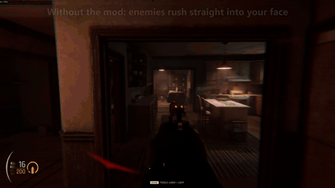
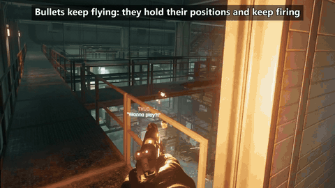
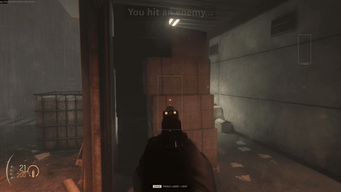
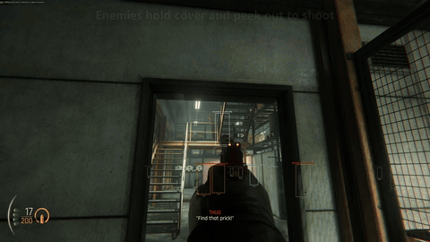
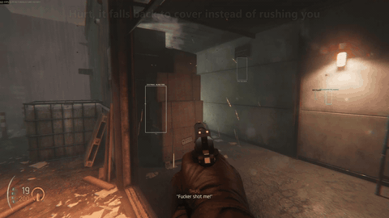
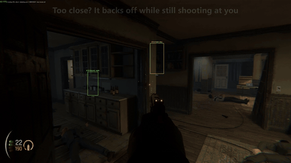
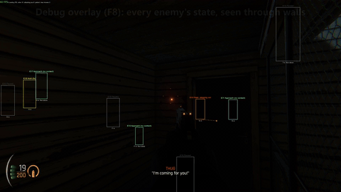
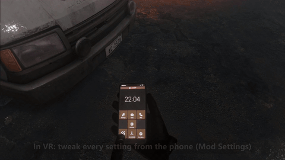

# Tactical Enemy AI

A MelonLoader mod for **Gunman Contracts – Stand Alone** (VR and flat). Enemies stop sprinting into your face. They fight
from cover, keep you pinned with blind fire, push up a few at a time and panic when you hit them.

<table>
  <tr>
    <td></td>
    <td></td>
  </tr>
  <tr>
    <td></td>
    <td></td>
  </tr>
  <tr>
    <td></td>
    <td></td>
  </tr>
  <tr>
    <td></td>
    <td></td>
  </tr>
</table>

## What changes

- **Cover.** An enemy that loses sight of you takes cover, peeks out to a spot where it can see you, shoots, ducks back,
  and now and then moves to another cover spot.
- **Blind fire.** While you hide, enemies keep firing bursts at your cover to keep you pinned.
- **Smart pushes.** They hold for a few seconds, then move up cover to cover, two or three at a time. The last few get
  impatient and come for you.
- **Flank limit fixed.** The game's flank limit is broken, so any number of enemies could flank at once. Flanking now
  counts as an advance, so 2–3 move at a time.
- **Out-of-range advance.** An enemy that sees you beyond its 30 m firing range moves closer instead of just standing
  there.
- **No hide and seek.** An enemy that hasn't seen you for a while walks in until it finds you (up the stairs if you are on
  another floor) and fights from there, instead of camping somewhere on the map.
- **Panic fire.** Hit an enemy without killing it and it usually flinches and sprays wildly at your area.
- **Close range.** Get close and some enemies back off while still shooting; others stand their ground.
- **More enemies awake.** The game only keeps 3 enemies active and freezes the rest; the mod raises that to 6. In
  takedown, waiting enemies are sent at you so you don't have to search the map for the last ones.
- **No freezes.** Enemies fighting you are no longer frozen by the game's camping check or by blocking each other's path.
- **Debug overlay** (flat screen, F8): every enemy's state above its head, seen through walls.

## Install

1. Install [MelonLoader](https://github.com/LavaGang/MelonLoader) 0.7.x for the game.
2. Put `TacticalEnemyAI.dll` in the game's `Mods` folder.
3. Optional: [Mod Settings](https://www.nexusmods.com/gunmancontractsstandalone/mods/28) to change settings in game
   (phone tile in VR, Ctrl+M in flat).

Built for game version 0.3.1.1.

## Settings

With Mod Settings there are two pages. **Tactical Enemy AI** has the everyday ones: on/off, blind fire, panic fire and its
chance, back-off chance, how long enemies wait before advancing, how many advance at once, how close they come, how many
enemies stay awake, and the takedown wake-up. **Tactical Enemy AI (advanced)** has the rest: cover and peek timing, blind
fire bursts, panic details, distances, the debug overlay and log. Every setting has a default button.

Without Mod Settings, edit `UserData/MelonPreferences.cfg`, sections `[TacticalEnemyAI]` and `[TacticalEnemyAI_Advanced]`.

## Compatibility

- **Stealth AI Fix:** don't use both. They change the same chase and flanking code in opposite directions.
- **Knee Shot Stun:** works. With it installed, a leg hit keeps its knee-down stun even when the enemy panics
  (setting `Panic: leg hits`, Auto by default).
- Other mods that don't touch enemy AI are fine.

## Build

```
dotnet build -c Release
```

The project references the game's MelonLoader assemblies from the default Steam folder. For another location copy
`GameDir.local.props.example` to `GameDir.local.props` and set the path.

## For modders

What I found out about the game's enemy AI while making this (the update loop, why enemies rush, cover, blind fire, the
active-enemy limit, freezes, hit stun) is in [docs/ENEMY_AI.md](docs/ENEMY_AI.md), to save the next modder some digging.

## Credits

Thanks to Evgeeso for the [Gunman Contracts mods repo](https://github.com/EvheniiS/GunmanContracts-Mods): its IL2CPP tools
and game notes made this possible, and Mod Settings gives this mod its in-game menu.

MIT license, see [LICENSE](LICENSE).
